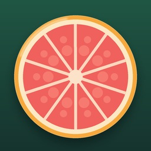
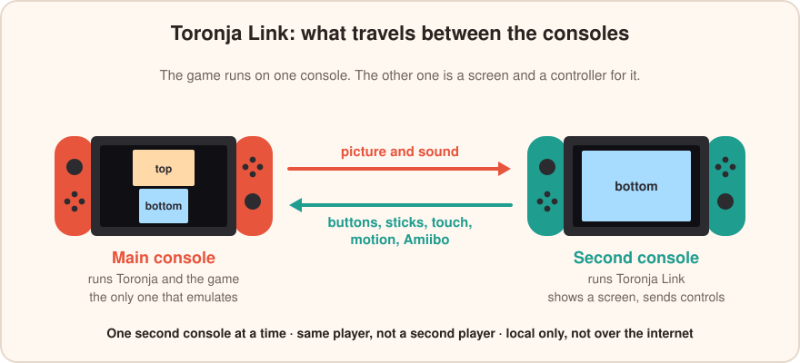
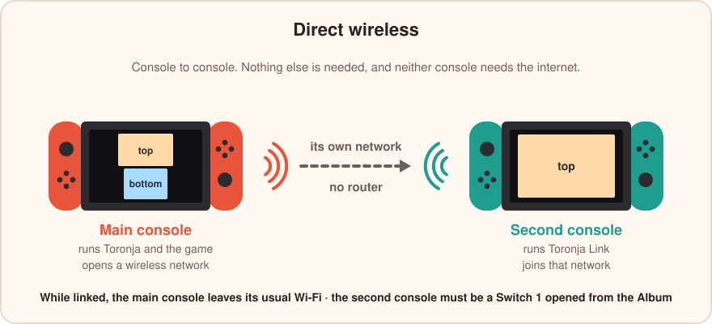
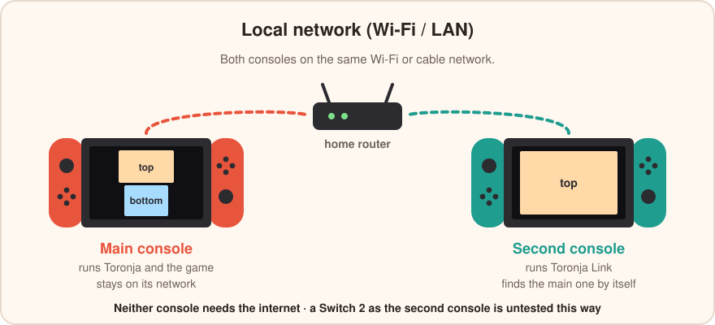

<h1 align="center">Toronja</h1>

  

**Toronja** is a Nintendo 3DS emulator for the **Nintendo Switch 2** and the **Nintendo Switch**,
with a companion app, **Toronja Link**, that lets a second console show one of the 3DS's two
screens and play along.

It is a continuation of [Dekopon](https://github.com/PalindromicBreadLoaf/dekopon) by
PalindromicBreadLoaf, which is itself the Switch port of [Azahar](https://github.com/azahar-emu/azahar).
Everything that makes games run is theirs; see [Credits](#credits).

> **Status.** This is homebrew under active development, built and tested by one person on
> two consoles. Things marked *untested* below compile and are believed to work, and that is
> all that is claimed for them.

## What is different from Dekopon

### Runs on Switch 2

- A port to the Switch 2 (kaiHEN + ounce-devkit, Vulkan through OunceVK/NVK), alongside the
  Switch 1 build, from the same source and with the same version number.
- Performance work found by profiling real games on both consoles:
  - Majora's Mask 3D's Sheikah Stone visions list went from 9 fps to 30 on Switch 2
    (`std::call_once` on every guest `LDREX`/`STREX`, in dynarmic's spin lock).
  - The slowdown with the sun in view in the Zelda games (a depth-buffer read-back every
    frame): host-imported download memory on Switch 2; on Switch 1, a copy out of uncached
    driver memory and a read-back of only the part the game looks at.
  - Switch 1: pipelines that had waited too long are built by the draw that needs them, so
    a game no longer shows an empty level while one slow worker catches up; closing a game
    no longer builds the whole queue first; shader caches survive app updates.
- Reset presets that stay correct ("Default", "Default without async shaders").

### GameShare and Toronja Link

- **Toronja Link**, a second homebrew app for another Switch or Switch 2: it shows the top
  screen, the bottom screen or both, sends its buttons, sticks, touch screen and motion
  back, and can play the game's sound.
- Console to console over **direct wireless** (no router), or over the network both are on.
- The link can be made **from the library, before any game**: Toronja Link then shows the
  games as a grid of icons, a large Play button with the game's animated banner once one is
  picked, and in the options what the focused setting does and every value it can take.
- The second console's Amiibo reader can serve the game; `+` and `-` on it open the in-game
  menu on the main console.

### Library

- A shelf of game **cases** instead of a list: nine styles (Coverflow, Shelf, Carousel, Arc,
  Stack, Spotlight, Bookshelf, Pile, Showroom), cases drawn in 3D with spine, hinge and seam.
- **Covers** from GameTDB, downloaded by the console, sent from a PC
  (`tools/covers/fetch_covers.py`) or **shared from one console to another** for a console
  kept off the internet.
- `A` brings the selected case forward to turn and look at before starting - or shows the
  game's **animated 3D banner**, the one the 3DS shows in its HOME Menu, read out of the game
  and drawn in software (`src/citra_switch/banner3d.h`).
- Dark and light themes, menu sounds, touch everywhere.

### Menus

- Options in a drawer of pages, with the risky ones under *Advanced* behind a warning, and
  an explanation for every setting (`X`).
- A redesigned in-game menu: screen layouts as tiles, quick actions (save states, GameShare,
  resolution, FPS, Amiibo, cheats), full settings with the ones that cannot change mid-game
  locked.
- Amiibo with nothing to set up: the reader turns on when the game asks.
- The screen layout last used is the one the next game starts in.

## Installing

1. Take the file for your console from the [releases](https://github.com/Olmectron/toronja/releases)
   (or from the artifacts of the latest build under *Actions*):
   `toronja-switch2.nro` or `toronja-switch1.nro`, and `toronja-link-switch1.nro` or
   `toronja-link-switch2.nro` for a second console.
2. Copy it to `/switch/` on the SD card and start it from the Homebrew Menu.
3. Put your own game dumps in the games folder shown under *Options > Folders*
   (`/switch/toronja/roms/` by default).

Coming from Dekopon, or from a build of Toronja that still used `/switch/dekopon/`: the folder
is renamed to `/switch/toronja/` the first time this version starts, with everything in it.
Dekopon itself, if you keep it on the card, starts afresh after that.

No games, keys or system files are included, and none will be provided.

## Folders

Everything lives under `/switch/toronja/` (changeable in the options):

| Folder | What goes in it |
| --- | --- |
| `roms/` | Your games |
| `covers/`, `covers/full/` | Front covers and whole wraps, named by game code (`AQEE.jpg`) |
| `cheats/<TITLE_ID>.txt` | Gateway / Action Replay cheats |
| `load/mods/<TITLE_ID>/` | LayeredFS mods (`romfs`, `exefs`, `exheader.bin`) |
| `load/textures/<TITLE_ID>/` | Texture packs |
| `amiibo/`, `camera/` | Amiibo dumps and still images for the cameras |
| `log/` | `azahar_log.txt`, and `crash.txt` after a crash |

Save backups use Checkpoint's layout under `sdmc:/3ds/Checkpoint/`, so a real 3DS can read them.

## Toronja Link

  

The game runs on **one** console, the main one. **Toronja Link** on a second console is a
screen and a controller for that game: it shows the top screen, the bottom screen or both,
and sends its buttons, sticks, touch screen, motion sensor and Amiibo reader back. It does
not emulate anything and needs no games of its own.

Open **Toronja Link** on the second console and, on the main one, the link button beside the
options (right stick click) or *Options > GameShare*. Choose the same kind of connection on
both.

### Direct wireless

  

The main console opens a wireless network of its own and the second one joins it: no router,
no internet. While linked, the main console is off its usual Wi-Fi.

On a Switch 1, start Toronja Link from the Homebrew Menu opened through the **Album**: opened
over a game, the system refuses to join another title's wireless network. Toronja Link greys
the option out where it cannot work and says why.

### Local network (Wi-Fi / LAN)

  

Both consoles on the same network. The second one finds the main one by itself; if it does
not, write the main console's address in `sdmc:/switch/toronja-link.txt`. Nothing leaves the
local network, and neither console needs the internet.

### Which console can be the second one

| Second console (runs Toronja Link) | Direct wireless | Local network |
| --- | --- | --- |
| Switch 1, Homebrew Menu from the Album | Works | Works |
| Switch 1, Homebrew Menu over a game | Refused by the system (`0xc2cb`) | Works |
| Switch 2 | **Not available** | *Untested* |

On a Switch 2 homebrew currently runs as an application, never as an applet (there is no
Album route there yet), and in the one attempt made the wireless service would not even start
for Toronja Link (`ldnInitialize` returned `0x2ecb`). Until that changes, use a Switch 1 as
the second console for direct wireless. The Switch 2 as the *main* console (the one that
opens the network) works; that pair - Switch 2 main, Switch 1 second - is the one this was
developed and tested on.

### Limits of Toronja Link

- **It is not a second player.** The second console's controls are added to the main
  console's own: both drive the same 3DS. It is for playing from the other console, or for
  holding the bottom screen in your hands, not for two-player games.
- **One second console at a time.**
- **Local only.** Console to console or the same home network; not over the internet.
- **It is a video of the screen.** The picture is sent at the 3DS's own size (400 x 240 top,
  320 x 240 bottom) as JPEG frames, and enlarged on the second console; a higher internal
  resolution on the main console does not make it sharper. When the link struggles the
  picture gets coarser so the frame rate holds, and a lost frame is skipped, not resent.
- **A little delay.** Barely noticeable on a good link; it grows on a crowded Wi-Fi.
- **Sound is optional and off unless asked for** on the second console, and the main console
  can refuse it. It is sent uncompressed, so it adds to the traffic.
- **Sharing costs the main console some work** (it compresses every frame). A game already
  short of frame rate, on a Switch 1 above all, can lose a little more.
- **Direct wireless takes the main console off its Wi-Fi** for as long as the link lasts.
- **Amiibo go one way.** A figure read on the second console is loaded in the game; the game
  cannot write back to it.
- **No USB cable.** It is written, but the Switch 2 loader grants neither `usb:ds` nor
  `usb:hs`.
- **No PC or phone app.** `tools/gameshare/receiver.py` exists for testing only.

## Building

There is no local toolchain to set up: every push is built by GitHub Actions
(`.github/workflows/`), and the `.nro` files are the artifacts of each run.

| Workflow | Builds |
| --- | --- |
| `toronja-switch2` | Toronja for Switch 2 |
| `toronja-switch1` | Toronja for Switch 1 (with the NXVK Vulkan driver) |
| `toronja-link` | Toronja Link for both consoles |
| `ui-preview` | The library and options rendered to PNG on a PC, and the two icons |

The toolchain image is described in `docker/switch2/Dockerfile`; `docker/switch2/build.sh` and
`docker/switch1/build.sh` are the builds themselves. `SWITCH2_HANDOFF.md` has the notes of the
port: what was tried, what the loader does and does not grant, and how each fix was found.

## Known limits

- USB sharing between consoles is written but switched off: the Switch 2 loader grants
  neither `usb:ds` nor `usb:hs`.
- The 3D banner is drawn with its materials and plays its jingle, but with stand-in
  lighting and without material animations or the banner's own camera.
- Much of the newest work (the link from the library, cover sharing, the banner on the
  console and on the second one) is *untested* beyond compiling and a PC prototype.
- On Switch 1, start Toronja over a game (title takeover): from the Album there is not
  enough memory for it.
- The frame rate dips for a moment the first time a place is entered, while its code is
  compiled.
- Frame generation (LSFG) is not built into these binaries.

## Credits

- **[Azahar](https://github.com/azahar-emu/azahar)** and, before it, Citra and Lime3DS: the
  emulator.
- **[Dekopon](https://github.com/PalindromicBreadLoaf/dekopon)** by PalindromicBreadLoaf: the
  Switch port Toronja continues - the frontend it grew from, the Vulkan work on NXVK, save
  management, the updater, USB storage and much else.
- **Olmectron**: Toronja - the Switch 2 port, GameShare and Toronja Link, the library, the
  menus and the performance work listed above.
- Cover art comes from [GameTDB](https://www.gametdb.com/) at the user's request; none is
  distributed here.

## License

GPL-2.0-or-later, as Azahar and Dekopon (`license.txt`). Bundled dependencies keep their own
licences; see `THIRD_PARTY_NOTICES.md`.

Nintendo 3DS, Nintendo Switch and Nintendo Switch 2 are trademarks of Nintendo. Toronja is not
affiliated with, authorised or endorsed by Nintendo.
